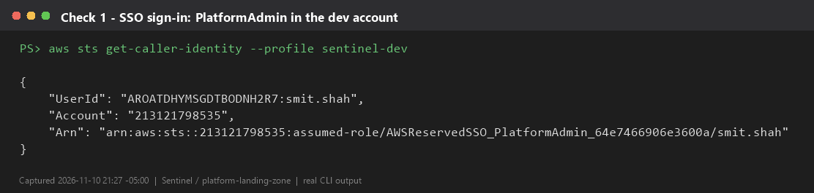
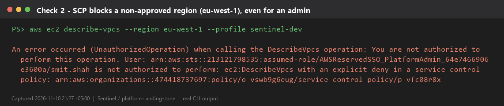
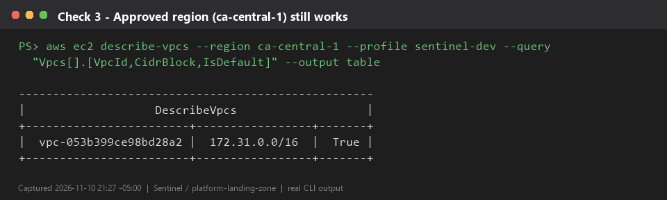
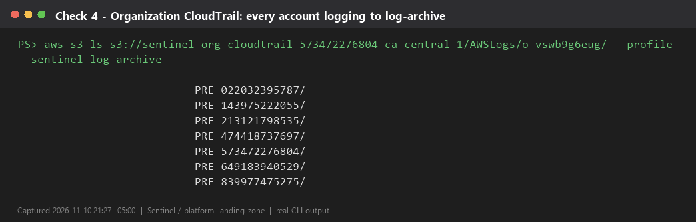

# platform-landing-zone

Week 1 of **Sentinel**: the multi-account AWS foundation for the NRS Digital Tax Platform.

It creates an AWS Organization with 6 member accounts, service control policies (SCPs), an organization-wide CloudTrail that writes to a locked-down log archive account, and IAM Identity Center permission sets for human access.

> Use a **brand-new personal AWS account** as the management account. Never use an employer account.

## Layout

```
stacks/
├── 00-bootstrap/          # S3 bucket for remote state (local state, run once)
├── 10-organization/       # Organization, OUs, member accounts, SCPs
├── 20-logging/            # Org CloudTrail -> KMS-encrypted bucket in log-archive
└── 30-identity-center/    # Groups, permission sets, account assignments
docs/adr/                  # Architecture decision records
.github/workflows/         # PR checks: fmt, validate, Checkov
```

Each stack has its own state file, so a mistake in one can't damage another. Stacks are applied in numeric order.

## Organization design

```
Root
├── Security
│   ├── log-archive        # CloudTrail logs, write-once
│   └── security-tooling   # GuardDuty / Security Hub admin (week 4+)
├── Infrastructure
│   └── shared-services    # ECR, CodeArtifact, Argo CD, Backstage
├── Workloads
│   ├── NonProd
│   │   ├── dev
│   │   └── staging
│   └── Prod
│       └── prod
└── Suspended              # Decommissioned accounts, everything denied
```

| SCP | Attached to | What it does |
| --- | --- | --- |
| `sentinel-baseline-guardrails` | Root | Blocks leaving the org, disabling CloudTrail/Config/GuardDuty, and root-user actions |
| `sentinel-region-guardrail` | Root | Allows only `ca-central-1` (primary) and `us-east-1` (DR + global services) |
| `sentinel-deny-all` | Suspended OU | Denies everything |

SCPs never affect the management account, so keep workloads out of it.

## Prerequisites

- Terraform >= 1.10 (for S3 native state locking) or OpenTofu >= 1.10
- AWS CLI v2, signed in to the management account with an admin role
- 6 unused email addresses for the member accounts. Gmail plus-addressing works: `you+sentinel-dev@gmail.com`
- Optional: `pre-commit`, `checkov`, `tflint`

## Apply order

### 1. Bootstrap remote state (once)

```bash
cd stacks/00-bootstrap
terraform init
terraform apply
terraform output -raw backend_hcl > ../backend.hcl
```

`backend.hcl` is shared by every later stack and is git-ignored.

### 2. Organization and accounts

```bash
cd ../10-organization
cp terraform.tfvars.example terraform.tfvars   # edit the emails
terraform init -backend-config=../backend.hcl
terraform plan -out tfplan
terraform apply tfplan
```

Account creation takes a few minutes per account.

> **Account deletion is slow and limited.** AWS lets you close only a small share of member accounts in a rolling 30-day window, and closed accounts stay in a suspended state for 90 days. The accounts use `prevent_destroy` for this reason. Double-check the emails before applying.

### 3. Logging

```bash
cd ../20-logging
terraform init -backend-config=../backend.hcl
terraform apply
```

This stack assumes `OrganizationAccountAccessRole` in `log-archive` to create the bucket and key, then creates the organization trail in the management account.

### 4. Identity Center

IAM Identity Center can't be enabled through the API for an organization instance. First:

1. Open the IAM Identity Center console in **ca-central-1**.
2. Click **Enable**. Choose the organization instance.

Then:

```bash
cd ../30-identity-center
cp terraform.tfvars.example terraform.tfvars   # add your admin user
terraform init -backend-config=../backend.hcl
terraform apply
```

Users created through the API don't get an invitation email automatically. In the Identity Center console, open **Users**, select your user, choose **Reset password**, and send the email. Set a password, register MFA, and sign in through the AWS access portal. From now on, use Identity Center instead of the management account's root user or IAM users.

## Verify (week 1 exit gate)

```bash
# 1. You can sign in through Identity Center
aws configure sso          # profile: sentinel-dev, PlatformAdmin
aws sts get-caller-identity --profile sentinel-dev

# 2. The region guardrail blocks other regions (expect AccessDenied / UnauthorizedOperation)
aws ec2 describe-vpcs --region eu-west-1 --profile sentinel-dev

# 3. The allowed region works
aws ec2 describe-vpcs --region ca-central-1 --profile sentinel-dev

# 4. CloudTrail logs arrive in log-archive (allow ~15 minutes)
aws s3 ls s3://<trail-bucket>/AWSLogs/ --recursive --profile sentinel-log-archive | head
```

Record these four results (screenshots or terminal output) for your write-up.

## Week 1 evidence

All four exit-gate checks passed on 2026-11-10. Each image is real CLI output captured by [`scripts/capture-week1-evidence.ps1`](scripts/capture-week1-evidence.ps1).

**1. Single sign-on works.** PlatformAdmin in the dev account through IAM Identity Center, with no IAM users or access keys.



**2. The region guardrail blocks everyone, admins included.** An explicit deny from `sentinel-region-guardrail` stops eu-west-1.



**3. Approved regions still work.** The same call in ca-central-1 succeeds.



**4. Every account logs to the archive.** The organization trail writes one folder per member account into the locked log-archive bucket.



## Branching and releases

- Short-lived branches off `main` (`feat/…`, `fix/…`), Conventional Commits, PR required.
- PR checks: `terraform fmt`, `validate`, Checkov.
- `plan` is run and reviewed locally for now. Week 7 moves plan/apply into GitHub Actions with OIDC.

## Cost

Organizations, SCPs and Identity Center are free. CloudTrail's first management-event trail is free; you pay for S3 storage and KMS (about US$1/month per key plus requests).
